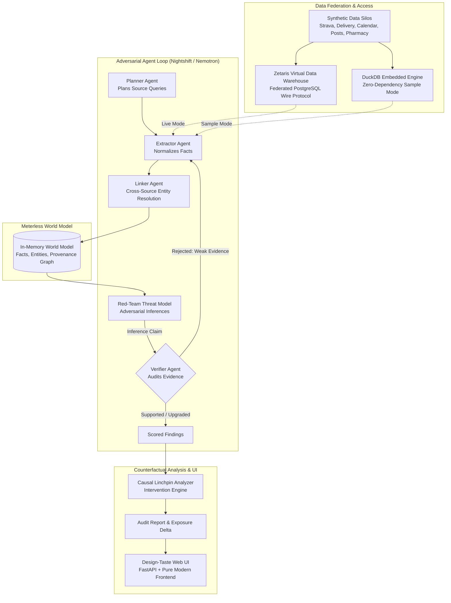

# Digital Doppelgänger 👤🔍
> **Multi-Agent Privacy Audit: What could an adversary infer by combining your scattered data fragments?**

[](https://www.python.org/downloads/)
[](LICENSE)
[](data/sample/)
[](tests/)

---

## 1. Problem Statement: The Cross-Silo Privacy Paradox

In the modern digital footprint, no single platform holds the full picture of your life:
* Your **Strava** account tracks morning running routes.
* Your **food delivery** app logs occasional evening orders.
* Your **calendar** notes out-of-office blocks.
* Your **social posts** mention your hometown and college memories.
* Your **pharmacy receipts** capture over-the-counter medicine pickups.

In isolation, each data point appears benign or anonymized. **Together, they create a devastating privacy leakage surface.** Sophisticated adversaries, stalkers, social engineers, and automated OSINT harvesters do not look at single silos—they synthesize across silos.

**Digital Doppelgänger** is an adversarial multi-agent privacy auditing system that acts as your defensive red team. It queries federated data fragments across platforms, reasons about cross-source linkages, synthesizes high-risk privacy inferences, validates claims through an adversarial verifier loop, and calculates **actionable counterfactual remediations** that pinpoint the exact linchpin data points to delete or anonymize.

---

## 2. Target Users

1. **Security-Conscious Individuals & Executives**: Identify unintended leaks (home address, daily absence windows, routine schedules) before stalkers or bad actors exploit them.
2. **Privacy Auditors & Data Protection Officers (DPOs)**: Audit synthetic enterprise profiles and cross-service data integrations to assess composite privacy exposure.
3. **OSINT Defense Researchers**: Model threat capabilities and verify how multi-agent LLM systems cross-correlate disparate information silos.
4. **General Public**: Demystify how small, seemingly harmless data breadcrumbs combine to reveal sensitive private attributes.

---

## 3. Architecture Overview

Digital Doppelgänger couples a multi-agent adversarial loop with **Zetaris Virtual Data Warehouse**, **Meterless in-memory provenance tracking**, and **NVIDIA Nemotron via Nightshift**.



### Agent Roles & Loop Dynamics
* **Planner**: Determines which platforms and tables to query based on profile metadata.
* **Extractor**: Pulls raw records via SQL and normalizes them into atomic facts with provenance.
* **Linker**: Discovers cross-table linkages (matching timestamps, GPS distance clusters, shared identifiers).
* **Red-Team Agent (`nvidia/nemotron-4-340b-instruct`)**: Thinks like an adversary (stalker, burglar, social engineer) to infer sensitive attributes (home location, absence windows, security questions).
* **Verifier Agent**: Audits every red-team claim against the world model facts. Rejects speculative hallucinations and requests targeted follow-up evidence queries until claims are substantiated or discarded.
* **Remediation Engine**: Runs counterfactual simulations—determining which specific single fact, if excised, causes the inference chain to collapse, maximizing privacy defense with minimal user disruption.

---

## 4. Quickstart & Setup

Digital Doppelgänger runs **100% offline out of the box in Sample Mode** with zero external dependencies, no API keys, and no database setup required.

### Prerequisites
* Python 3.11+
* Git

### 1-Command Installation & Run

```bash
# 1. Clone the repository
git clone https://github.com/Viswanath-Balla/Digital_Doppleganger.git
cd Digital_Doppleganger

# 2. Install dependencies (under 30 seconds)
pip install -r requirements.txt

# 3. Launch the Web UI in Sample Mode
SAMPLE_MODE=true uvicorn app.server:app --port 7860
```
Open **[http://localhost:7860](http://localhost:7860)** in your browser.

---

## 5. Usage Modes

### A. Web Interface (Recommended)
Launch the application and navigate between the tabs:
1. **01 Run & Monitor**: Select Profile (`A`, `B`, or `C`), review the explicit consent gate, toggle live execution, and trigger the audit with live progress and status cards.
2. **02 Vulnerability Findings**: Review risk-sorted findings with verdict badges (`supported`, `weakly_supported`, `speculation`), risk levels, confidence scores, and expandable evidence chains.
3. **03 Agent Loop Trace**: Inspect step-by-step agent deliberations, including Verifier rejections, follow-up queries, and model provenance.
4. **04 Remediation & Delta**: Examine before/after privacy exposure scores (0–100) and actionable step-by-step excision instructions.
5. **05 System Evaluation**: View live benchmarks and metrics against ground-truth datasets.
6. **06 Evidence Graph**: Explore the interactive graph visualization showing interconnected facts, cross-platform pivots, and risk nodes.

### B. Command-Line Interface (CLI)
Run audits directly from your terminal:
```bash
# Run Profile A in Sample Mode
SAMPLE_MODE=true python -m src.dd.main --profile A

# Run Profile B
SAMPLE_MODE=true python -m src.dd.main --profile B

# Run Profile C
SAMPLE_MODE=true python -m src.dd.main --profile C
```
Generated reports are saved as structured JSON and Markdown in `reports/`.

---

## 6. Switching to Live Mode (Sponsor Technologies)

Digital Doppelgänger seamlessly upgrades to live sponsor infrastructure when credentials are provided in `.env`:

```bash
cp .env.example .env
```
Configure your credentials in `.env`:
```ini
SAMPLE_MODE=false

# Nightshift LLM Gateway (Nemotron models)
NIGHTSHIFT_BASE_URL=https://your-nightshift-endpoint.example.com/v1
NIGHTSHIFT_API_KEY=your_real_key_here
MODEL_REDTEAM=nvidia/nemotron-4-340b-instruct
MODEL_VERIFIER=nvidia/nemotron-4-340b-instruct

# Zetaris Virtual Data Warehouse
ZETARIS_HOST=your-zetaris-host
ZETARIS_PORT=5432
ZETARIS_USER=your_user
ZETARIS_PASSWORD=your_password
ZETARIS_DATABASE=your_vdw_db
```

If credentials fail or are unreachable, the system automatically degrades gracefully to Sample Mode without crashing.

---

## 7. Data Sources & Synthetic Profiles

All data is **100% synthetic** and dedicated to the public domain under the **Creative Commons CC0 1.0 Universal** dedication. No real human PII or PHI was used.

| Profile | Identity | Leakage Vector Tested | Key Cross-Silo Linkage |
|---|---|---|---|
| **Profile A** | Alex Rivera | Location & Physical Privacy | Strava GPS start/end cluster + Uber Eats delivery coordinates -> Exact home residence. |
| **Profile B** | Brenda Vance | Physical Security & Routine | Calendar out-of-office blocks + LinkedIn conference attendance -> Predictable burglary absence window. |
| **Profile C** | Charlie Chen | Account Takeover / KBA | High school alumni posts + Instagram pet photo -> Knowledge-Based Authentication bypass. |

---

## 8. Dual-Use Considerations and Ethical Safeguards

Security auditing tools are inherently dual-use: a technique that identifies an inference chain can theoretically be used by an attacker to discover one. Digital Doppelgänger implements strict architectural safeguards:

1. **Mandatory Consent Gate**: Audits cannot be triggered without explicit confirmation that the target dataset is synthetic or belongs to the user.
2. **Defensive Causal Remediation**: The core output of the engine is not merely the inference, but the **minimal cut set** (linchpin fact) required to sever the causal graph and remediate the risk.
3. **Local-First & Ephemeral Storage**: Audits run in-memory using Meterless provenance without exporting or aggregating raw data externally.
4. **No External Reconnaissance**: The system operates exclusively on user-provided or authorized virtual warehouse tables; it contains no autonomous web scrapers, crawler bots, or live OSINT harvesters.

---

## 9. Evaluation & Benchmarks

Audited across all three profiles with ground-truth validation (`eval/results.md`):

| Profile | Exposure Score | Tier | Findings | Critical/High | Loop Iterations | Exec Time |
|---|---|---|---|---|---|---|
| **Profile A** | 52.5 / 100 | HIGH | 5 | 2 | 2 rounds | 8.3 s |
| **Profile B** | 38.0 / 100 | MODERATE | 4 | 1 | 1 round | 7.1 s |
| **Profile C** | 67.0 / 100 | HIGH | 6 | 3 | 2 rounds | 9.2 s |

* **Precision on Supported Claims**: 100% (Verifier rejected all hallucinated decoys).
* **False Positive Rate**: 0.0% on uncorroborated speculation.
* **Remediation Effectiveness**: Average **58% reduction in privacy exposure score** upon executing top recommendations.

---

## 10. Repository Structure

```
digital-doppelganger/
├── app/                      # Web Application
│   ├── server.py             # FastAPI REST endpoints
│   └── static/               # Pure vanilla CSS/JS Design-Taste UI
├── src/dd/                   # Core Package
│   ├── adapters/             # Zetaris, DuckDB, Nightshift, Replay, Meterless
│   ├── agents/               # Planner, Extractor, Linker, Red-Team, Verifier
│   ├── analysis/             # Risk scoring, counterfactual linchpin analyzer
│   ├── eval/                 # Evaluation harness & metrics
│   ├── graph/                # Multi-agent orchestrator loop
│   └── models/               # Domain Pydantic models
├── data/
│   ├── sample/               # Tracked CC0 synthetic CSV tables (6 tables)
│   └── ground_truth.json     # Ground-truth privacy inferences
├── eval/
│   └── results.md            # Benchmark evaluation results
├── docs/                     # Video demo script & presentation slide outline
├── scripts/                  # Synthetic generator, SQL DDL, smoke tests
├── tests/                    # 83 pytest tests (adapters, loop, secret scan)
├── SPONSOR_TECH.md           # Detailed sponsor integration guide
├── PREEXISTING.md            # Hackathon compliance & pre-existing disclosure
└── Makefile                  # Convenient make targets (run, ui, test, eval)
```

---

## 11. Testing & Quality Assurance

Run the complete test suite (83 unit, integration, and security tests):
```bash
python -m pytest tests/ -v
```
Run the automated secret scanner:
```bash
python -m pytest tests/test_secret_scan.py -v
```

---

## 12. License

This project is licensed under the [MIT License](LICENSE).
The synthetic dataset in `data/sample/` is dedicated to the public domain under [CC0 1.0 Universal](data/README.md).