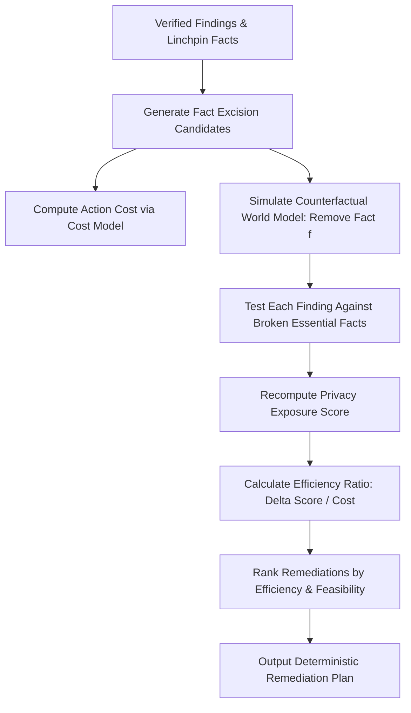

# Digital Doppelgänger: Agent Prompt Architecture & Remediation Engine 🛡️📋

## 1. Overview & Architecture

Digital Doppelgänger implements a modular, per-agent Markdown prompt architecture located in [`src/dd/agents/prompts/`](file:///c:/Users/siddh/OneDrive/Desktop/dd/Digital_Doppleganger/src/dd/agents/prompts/). Each agent role is decoupled into a dedicated, version-controlled Markdown prompt loaded dynamically at runtime via [`PromptLoader`](file:///c:/Users/siddh/OneDrive/Desktop/dd/Digital_Doppleganger/src/dd/agents/prompt_loader.py).

### Core Design Principles
1. **Agentic Pairings**: Agents operate in complementary adversarial or verification pairs (Planner/Extractor, Linker/WorldModel, Red-Team/Verifier, Reporter/Remediation).
2. **Zero Hardcoded Model Identifiers**: Prompts, source code, and documentation never hardcode specific model IDs. Model configurations are injected dynamically from environment variables (`MODEL_PLANNER`, `MODEL_EXTRACTOR`, `MODEL_REDTEAM`, `MODEL_VERIFIER`, etc.) into [`Settings`](file:///c:/Users/siddh/OneDrive/Desktop/dd/Digital_Doppleganger/src/dd/config.py).
3. **Auditable Provenance**: Every prompt file contains version metadata (`Version: 2.0.0`) and is hashed at runtime using SHA-256. Prompt file paths, versions, and SHA-256 hashes are attached to every [`TraceRecord`](file:///c:/Users/siddh/OneDrive/Desktop/dd/Digital_Doppleganger/src/dd/models/domain.py) for reproducible compliance auditing.
4. **Code-Level Enforcement**: Behavioral constraints specified in prompt files are programmatically validated and enforced in Python code, preventing hallucination or protocol bypass.

---

## 2. Agent Prompt Catalog & Code Enforcement

| Prompt File | Agent Role | Pair / Counterpart | Version | Code Enforcement Location |
| :--- | :--- | :--- | :--- | :--- |
| [`planner.md`](file:///c:/Users/siddh/OneDrive/Desktop/dd/Digital_Doppleganger/src/dd/agents/prompts/planner.md) | Query & platform scoping | Extractor | 2.0.0 | [`PlannerAgent.run`](file:///c:/Users/siddh/OneDrive/Desktop/dd/Digital_Doppleganger/src/dd/agents/planner.py) |
| [`extractor.md`](file:///c:/Users/siddh/OneDrive/Desktop/dd/Digital_Doppleganger/src/dd/agents/prompts/extractor.md) | Structured fact normalization | Linker / World Model | 2.0.0 | [`ExtractorAgent.run`](file:///c:/Users/siddh/OneDrive/Desktop/dd/Digital_Doppleganger/src/dd/agents/extractor.py) |
| [`linker.md`](file:///c:/Users/siddh/OneDrive/Desktop/dd/Digital_Doppleganger/src/dd/agents/prompts/linker.md) | Cross-source entity resolution | Red-Team | 2.0.0 | [`LinkerAgent.run`](file:///c:/Users/siddh/OneDrive/Desktop/dd/Digital_Doppleganger/src/dd/agents/linker.py) |
| [`redteam.md`](file:///c:/Users/siddh/OneDrive/Desktop/dd/Digital_Doppleganger/src/dd/agents/prompts/redteam.md) | Adversarial privacy synthesis | Verifier | 2.0.0 | [`RedTeamAgent.run`](file:///c:/Users/siddh/OneDrive/Desktop/dd/Digital_Doppleganger/src/dd/agents/red_team.py) |
| [`verifier.md`](file:///c:/Users/siddh/OneDrive/Desktop/dd/Digital_Doppleganger/src/dd/agents/prompts/verifier.md) | Adversarial critique & 3D rubric | Red-Team | 2.0.0 | [`VerifierAgent.run`](file:///c:/Users/siddh/OneDrive/Desktop/dd/Digital_Doppleganger/src/dd/agents/verifier.py) |
| [`reporter.md`](file:///c:/Users/siddh/OneDrive/Desktop/dd/Digital_Doppleganger/src/dd/agents/prompts/reporter.md) | Report generation & executive summary | Risk / Remediation | 2.0.0 | [`ReporterAgent.run`](file:///c:/Users/siddh/OneDrive/Desktop/dd/Digital_Doppleganger/src/dd/agents/reporter.py) |
| [`remediation.md`](file:///c:/Users/siddh/OneDrive/Desktop/dd/Digital_Doppleganger/src/dd/agents/prompts/remediation.md) | Actionable advice generation | Reporter | 2.0.0 | [`RemediationAgent.run`](file:///c:/Users/siddh/OneDrive/Desktop/dd/Digital_Doppleganger/src/dd/agents/remediation.py) |
| [`risk.md`](file:///c:/Users/siddh/OneDrive/Desktop/dd/Digital_Doppleganger/src/dd/agents/prompts/risk.md) | Privacy exposure scoring | Remediation Engine | 2.0.0 | [`RiskAgent.run`](file:///c:/Users/siddh/OneDrive/Desktop/dd/Digital_Doppleganger/src/dd/agents/risk.py) |

---

### Detailed Agent Specifications

#### 1. Planner (`planner.md`)
- **Role**: Analyzes the target profile's metadata and bounded privacy inquiry to formulate an optimal SQL extraction plan across federated data platforms.
- **Inputs**: Target `profile_id`, platform list, focus query.
- **Outputs**: Ordered list of SQL queries with explicit column selections and predicates.
- **Code Enforcement**: [`PlannerAgent.run`](file:///c:/Users/siddh/OneDrive/Desktop/dd/Digital_Doppleganger/src/dd/agents/planner.py) ensures only registered virtual tables are planned. Validated by schema checks.

#### 2. Extractor (`extractor.md`)
- **Role**: Executes planned SQL queries against the federated data layer (Zetaris or DuckDB) and transforms tabular records into immutable atomic `Fact` objects.
- **Inputs**: SQL queries from Planner.
- **Outputs**: List of typed [`Fact`](file:///c:/Users/siddh/OneDrive/Desktop/dd/Digital_Doppleganger/src/dd/models/domain.py) objects with cryptographic provenance (source table, row hash, timestamp).
- **Code Enforcement**: [`ExtractorAgent.run`](file:///c:/Users/siddh/OneDrive/Desktop/dd/Digital_Doppleganger/src/dd/agents/extractor.py) enforces that output objects strictly validate against the Pydantic `Fact` model. Raw SQL result rows never escape downstream without fact encapsulation.

#### 3. Linker (`linker.md`)
- **Role**: Discovers cross-silo links across facts using temporal proximity, spatial clustering, and identifier matching.
- **Inputs**: Normalized facts from World Model.
- **Outputs**: Resolves [`Entity`](file:///c:/Users/siddh/OneDrive/Desktop/dd/Digital_Doppleganger/src/dd/models/domain.py) instances and cross-fact links with explicit reason codes (`GEO_PROXIMITY`, `TEMPORAL_OVERLAP`, `SHARED_IDENTIFIER`, `SEMANTIC_CORRELATION`).
- **Code Enforcement**: [`LinkerAgent.run`](file:///c:/Users/siddh/OneDrive/Desktop/dd/Digital_Doppleganger/src/dd/agents/linker.py) strictly enforces radius limits (`settings.linker_gps_radius_meters = 100.0`) and temporal windows (`settings.linker_time_window_minutes = 30.0`), populating `LinkerBrief` summary statistics and attaching reason codes to World Model edge attributes.

#### 4. Red-Team Agent (`redteam.md`)
- **Role**: Acts as an adversarial OSINT attacker (stalker, burglar, credential harvester) synthesizing sensitive composite privacy inferences.
- **Inputs**: Strictly receives the **Linker Brief** (`brief`) and any Verifier critiques (`critique`). **Never receives raw database table rows.**
- **Outputs**: Candidate [`Finding`](file:///c:/Users/siddh/OneDrive/Desktop/dd/Digital_Doppleganger/src/dd/models/domain.py) objects citing specific `fact_ids`.
- **Code Enforcement**: [`RedTeamAgent.build_prompt`](file:///c:/Users/siddh/OneDrive/Desktop/dd/Digital_Doppleganger/src/dd/agents/red_team.py) validates privacy boundaries: if raw table dumps are passed, it isolates the context. Tested by `test_redteam_never_receives_raw_tables` in [`tests/test_phase5_enforcement.py`](file:///c:/Users/siddh/OneDrive/Desktop/dd/Digital_Doppleganger/tests/test_phase5_enforcement.py).

#### 5. Verifier Agent (`verifier.md`)
- **Role**: Adversarial critic auditing candidate inferences using a calibrated 3-dimension scoring rubric.
- **Inputs**: Candidate findings and facts stored in the Meterless World Model.
- **Rubric (0–9 scale)**:
  1. *Factual Basis (0–3)*: Verified existence and grounding of cited `fact_ids` in World Model.
  2. *Entailment Strength (0–3)*: Logical sufficiency of evidence (single source = max 1 pt, 2+ independent sources = 3 pts).
  3. *Absence of Benign Alternative (0–3)*: Ruling out innocent explanations (e.g., standard business travel or public venues).
- **Thresholds**:
  - `7–9`: **SUPPORTED** (High confidence, valid composite inference).
  - `4–6`: **WEAKLY_SUPPORTED** (Plausible but insufficient independent evidence).
  - `0–3`: **SPECULATION** (Decoys, unverified claims; generates actionable `fix_request`).
- **Code Enforcement**: [`VerifierAgent._score_finding_adversarial`](file:///c:/Users/siddh/OneDrive/Desktop/dd/Digital_Doppleganger/src/dd/agents/verifier.py) and `_extract_essential_facts` compute rubric dimensions directly against World Model records. Bounded 2-round loop in [`AgentLoop`](file:///c:/Users/siddh/OneDrive/Desktop/dd/Digital_Doppleganger/src/dd/graph/agent_loop.py) guarantees convergence without runaway latency.

#### 6. Reporter (`reporter.md`)
- **Role**: Synthesizes verified findings, exposure metrics, and audit traces into structured executive briefs and markdown reports.
- **Code Enforcement**: [`ReporterAgent.run`](file:///c:/Users/siddh/OneDrive/Desktop/dd/Digital_Doppleganger/src/dd/agents/reporter.py) filters speculative claims and formats actionable risk cards.

#### 7. Remediation Agent (`remediation.md`)
- **Role**: Translates counterfactual simulation outputs into user-friendly mitigation directives.
- **Code Enforcement**: Pairs with the deterministic [`RemediationEngine`](file:///c:/Users/siddh/OneDrive/Desktop/dd/Digital_Doppleganger/src/dd/remediation/engine.py).

#### 8. Risk Agent (`risk.md`)
- **Role**: Evaluates systemic multi-source exposure scores (0–100) before and after counterfactual interventions.
- **Code Enforcement**: [`RiskAgent.run`](file:///c:/Users/siddh/OneDrive/Desktop/dd/Digital_Doppleganger/src/dd/agents/risk.py) uses weighted risk matrices mapped to supported inference severities.

---

## 3. Deterministic Remediation Engine

### Why Deterministic?
LLM-generated remediation advice frequently suffers from:
1. **Hallucinated Interventions**: Suggesting settings or privacy toggles that do not exist in the target platforms.
2. **Suboptimal Advice**: Recommending broad account deletion when modifying a single timestamp or removing a single GPS tag breaks the inference chain.
3. **Non-Reproducibility**: Different runs producing inconsistent recommendations for identical privacy leaks.

To eliminate these vulnerabilities, Digital Doppelgänger implements a **100% deterministic, zero-LLM counterfactual simulation engine** in [`src/dd/remediation/`](file:///c:/Users/siddh/OneDrive/Desktop/dd/Digital_Doppleganger/src/dd/remediation/).

### Cost Model
User friction is modeled using discrete, configurable cost constants in [`src/dd/config.py`](file:///c:/Users/siddh/OneDrive/Desktop/dd/Digital_Doppleganger/src/dd/config.py) and [`src/dd/remediation/cost_model.py`](file:///c:/Users/siddh/OneDrive/Desktop/dd/Digital_Doppleganger/src/dd/remediation/cost_model.py):

| Action Type | Cost | Rationale |
| :--- | :--- | :--- |
| `DELETE_POST` | **1** | Low disruption; deleting a single post or GPS trace is trivial. |
| `GENERALIZE_FIELD` | **1** | Low disruption; coarsening a field (e.g. zip code instead of street address). |
| `CHANGE_RECOVERY_ANSWER` | **2** | Medium disruption; updating an account recovery question. |
| `REMOVE_DATA_SOURCE` | **3** | Higher disruption; disconnecting or deleting an entire application account. |

### Counterfactual Simulation Algorithm

1. **Candidate Identification**: For each verified finding, the engine identifies the `essential_fact_ids` determined during adversarial verification.
2. **Excision Simulation**: For each candidate fact $f$, the engine simulates world model state $W' = W \setminus \{f\}$.
3. **Chain Collapse Verification**: A finding $F$ collapses if:
   $$\text{essential\_fact\_ids}(F) \cap \{f\} \neq \emptyset \quad \lor \quad \text{sources}(W' \cap F) < \text{min\_independent\_sources}(F)$$
4. **Exposure Delta Calculation**: Baseline risk $E_0$ is compared with counterfactual risk $E'$ to determine $\Delta E = E_0 - E'$.
5. **Efficiency (ROI) Ranking**: Actions are prioritized by return on investment:
   $$\text{Efficiency} = \frac{\Delta E}{\text{Cost}(a)}$$

---

## 4. Verification & Audit Compliance

All prompt loading and remediation operations are verified by automated tests:
- [`tests/test_prompt_loader.py`](file:///c:/Users/siddh/OneDrive/Desktop/dd/Digital_Doppleganger/tests/test_prompt_loader.py): Verifies file discovery, frontmatter version parsing, SHA-256 calculation, caching, and loud failure on missing files.
- [`tests/test_remediation_engine.py`](file:///c:/Users/siddh/OneDrive/Desktop/dd/Digital_Doppleganger/tests/test_remediation_engine.py): Verifies zero-LLM determinism, cost model monotonicity, linchpin excision collapse, and exposure delta accuracy.
- [`tests/test_phase5_enforcement.py`](file:///c:/Users/siddh/OneDrive/Desktop/dd/Digital_Doppleganger/tests/test_phase5_enforcement.py): Validates prompt boundaries, raw data isolation, and rubric enforcement across all 8 agents.
