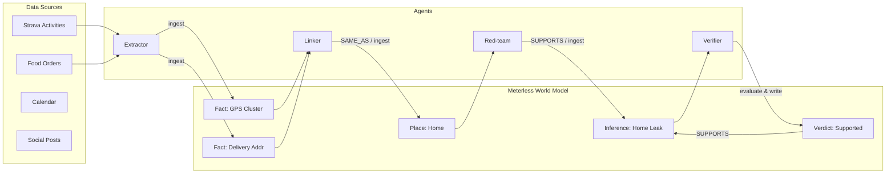

# Meterless World Model: Architecture, Schema Mapping & Assumptions

## 1. Engine Purpose in Digital Doppelgänger
The **Meterless World Model** acts as the decentralized, shared blackboard and state engine across the privacy audit agent loop. Instead of passing massive unstructured message histories between agents, agents write atomic facts, derived entities, inferences, and verdicts to the World Model.

---

## 2. Entity Type Mapping

| World Model Type | Domain Concept | Schema Fields | Primary Stable ID Seed |
|---|---|---|---|
| `Person` | Target persona (`profile_id`) | `profile_id, full_name, email, employer, handle` | `profile_id` |
| `Place` | Inferred physical location | `profile_id, name, address, lat, lon, confidence` | `profile_id + name + address` |
| `TimePattern` | Recurring routine or absence | `profile_id, pattern_type, start_window, end_window, recurrence` | `profile_id + pattern_type + start_window` |
| `Account` | External account / handle | `profile_id, platform, identifier, metadata` | `profile_id + platform + identifier` |
| `Fact` | Extracted atomic datum | `profile_id, source_table, source_row_id, key, value, timestamp` | `profile_id + key + value + source_table` |
| `Inference` | Privacy risk hypothesis | `profile_id, claim, category, attacker_models, confidence, status` | `profile_id + claim + category` |
| `Evidence` | Verifier evaluation / proof | `inference_id, verdict_label, confidence, rationale, model_name` | `inference_id + verdict_label + verified_by` |

---

## 3. Relation Type Semantics

- **`SUPPORTS`**: Directed link (`Child -> Parent`). Indicates that child entity (Fact, Place, TimePattern, or Verdict) provides corroborating evidence for the parent (Inference).
- **`DERIVED_FROM`**: Directed link (`Child -> Source`). Used when a higher-order concept (e.g., `Place` or normalized `Fact`) is synthesized directly from raw table telemetry.
- **`SAME_AS`**: Equivalence link between disparate entities (e.g. GPS origin coordinates `(39.7817, -89.6501)` resolved to delivery address `"742 Evergreen Terr"`).
- **`CONTRADICTS`**: Edge connecting mutually exclusive facts or claims across disparate sources. Crucially, the engine does not overwrite either fact; both remain queryable with full provenance.

---

## 4. Key Guarantees Implemented

1. **Idempotence**: Re-ingesting the exact same payload returns the identical stable entity ID. Duplicate nodes are never created.
2. **Provenance**: Every entity retains `_source`, `_sources`, `_created_by`, `_created_at`, and `_updated_at`.
3. **Versioned History**: Modifying attributes of an existing entity preserves historical snapshots in `_history` and increments `_version`.
4. **Lineage Traversal**: The `evidence_chain(inference_id)` method runs a breadth-first search backwards along incoming `SUPPORTS`, `DERIVED_FROM`, and `SAME_AS` edges, yielding an audit trail from root source rows up to the verified inference.

---

## 5. Assumptions for Sponsor Confirmation (Meterless Team)

When connecting to the live Meterless World Model service in Phase 4:
1. **API Protocol**: Assumed REST or gRPC endpoint for graph ingestion and edge creation.
2. **ID Generation**: Assumed client-side content-hash or server-side deterministic ID generation.
3. **Relation Naming**: Confirm whether `SUPPORTS`, `DERIVED_FROM`, `SAME_AS`, and `CONTRADICTS` match the exact enum strings in the sponsor schema or if lower-case is preferred.
4. **Persistence Layer**: Confirm whether the live Meterless backend uses a graph DB (e.g., Neo4j/RDF) or relational projection.
