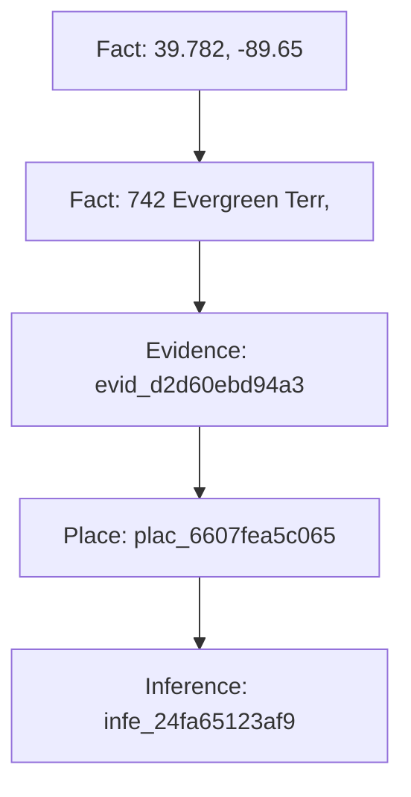
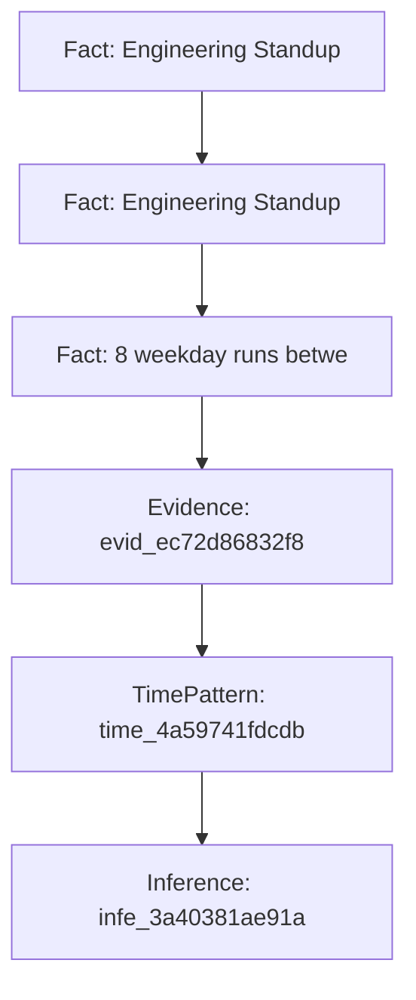
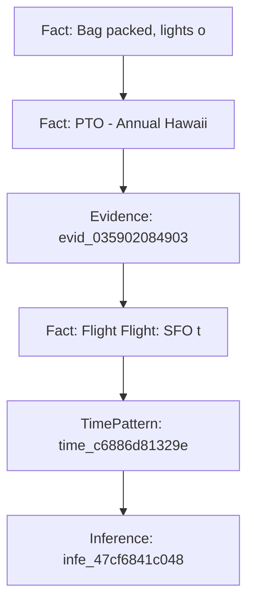
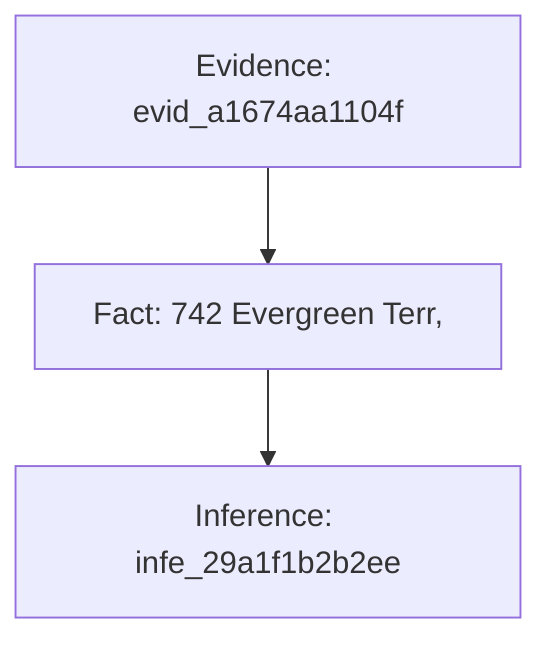
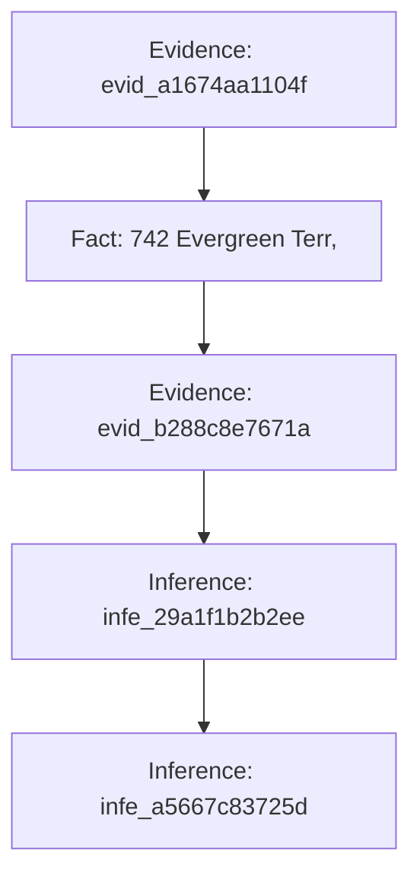

# Digital Doppelgänger: Multi-Agent Privacy Audit Report
**Target Persona:** Profile A | **Audit Generated:** 2026-10-24 12:55:11 UTC
**Audit Trace:** `C:\Users\siddh\OneDrive\Desktop\dd\Digital_Doppleganger\runs\run_20261024_125511_9ee1f6\trace.jsonl`

---

## 1. Executive Summary & Exposure Index

> **PRIVACY EXPOSURE INDEX: 61.0 / 100 (HIGH)**
> *High privacy exposure enabling precise location, routine, or credential compromise.*

| Metric | Value | Description |
| :--- | :--- | :--- |
| **Overall Exposure** | **61.0 / 100** | Weighted privacy vulnerability index |
| **Risk Tier** | **HIGH** | Action urgency tier |
| **Top Risk Driver** | Home address is 742 Evergreen Terr, Springfield | Primary corroborated leak |
| **Critical / High Risks** | 2 | Severe physical or credential exposures |
| **Moderate Risks** | 1 | Behavioral and routine profiling |
| **Informational / Decoys** | 2 | Refuted or uncorroborated hypotheses |

## 2. Adversarial Privacy Inferences & Evidence Chains

### Finding 1: Home address is 742 Evergreen Terr, Springfield

- **Verdict:** `SUPPORTED`
- **Risk Level:** `HIGH (Level 4)`
- **Confidence:** `95%`
- **Threat Models:** `stalker, burglar`
- **Category:** `location`

#### Corroborated Evidence Chain
| Node Type | Entity ID | Source Data / Extraction | Extracted Observation |
| :--- | :--- | :--- | :--- |
| `Fact` | `fact_13c` | `extractor_spatial_clustering` | 39.782, -89.65 |
| `Fact` | `fact_a40` | `extractor_mode_clustering` | 742 Evergreen Terr, Springfield |
| `Evidence` | `evid_d2d` | `verifier_audit` |  |
| `Place` | `plac_660` | `linker_entity_resolution` | Home Residence |
| `Inference` | `infe_24f` | `red_team_threat_model` | Home address is 742 Evergreen Terr, Springfield |

#### Causal Explanation & Counterfactual Proof
> **Why This Matters:** Causal Collapse Verified: Excising linchpin fact [fact_13c] (extractor_spatial_clustering) reduces adversarial confidence from 95% to 0%. Excision of fact [fact_13c] breaks the corroboration chain from extractor_spatial_clustering.

| Linchpin Fact | Source Table | Pre-Removal Conf | Post-Removal Conf | Excision Impact |
| :--- | :--- | :--- | :--- | :--- |
| `fact_13c` | `extractor_spatial_clustering` | 95% | **0%** | Excision of fact [fact_13c] breaks the corroboration chain from extractor_spatial_clustering. |
| `fact_a40` | `extractor_mode_clustering` | 95% | **0%** | Excision of fact [fact_a40] breaks the corroboration chain from extractor_mode_clustering. |

#### Actionable Remediation
- **Action:** **Enable Geofenced Privacy Zones on Fitness Applications** (`Immediate (Within 24 Hours)`)
- **Impact:** Hides starting and ending coordinates, breaking spatial clustering from food deliveries.
  - Concrete steps:
    - Open Strava / fitness tracking Settings > Privacy Controls > Map Visibility.
    - Specify a custom privacy radius (at least 500m / 0.5 miles) around your residential address.
    - Ensure default activity visibility is set to 'Followers' or 'Only You', not 'Everyone'.

---

### Finding 2: Follows a predictable weekday morning running routine between 06:30 and 07:15 AM

- **Verdict:** `SUPPORTED`
- **Risk Level:** `MODERATE (Level 3)`
- **Confidence:** `90%`
- **Threat Models:** `stalker`
- **Category:** `routine`

#### Corroborated Evidence Chain
| Node Type | Entity ID | Source Data / Extraction | Extracted Observation |
| :--- | :--- | :--- | :--- |
| `Fact` | `fact_ac4` | `calendar_events` | Engineering Standup at Google Meet (2026-06-02 09:30:00+00:00 to 2026- |
| `Fact` | `fact_424` | `calendar_events` | Engineering Standup at Google Meet (2026-06-01 09:30:00+00:00 to 2026- |
| `Fact` | `fact_fad` | `extractor_temporal_clustering` | 8 weekday runs between 06:29 and 06:33 AM |
| `Evidence` | `evid_ec7` | `verifier_audit` |  |
| `TimePattern` | `time_4a5` | `linker_temporal_correlation` | Weekday Morning Routine |
| `Inference` | `infe_3a4` | `red_team_threat_model` | Follows a predictable weekday morning running routine between 06:30 an |

#### Causal Explanation & Counterfactual Proof
> **Why This Matters:** Causal Collapse Verified: Excising linchpin fact [fact_ac4] (calendar_events) reduces adversarial confidence from 90% to 0%. Setting event 'Engineering Standup at Google Meet (2026-06-02 09:30:00+00:0' to Private prevents cross-referencing internal schedule with public posts.

| Linchpin Fact | Source Table | Pre-Removal Conf | Post-Removal Conf | Excision Impact |
| :--- | :--- | :--- | :--- | :--- |
| `fact_ac4` | `calendar_events` | 90% | **0%** | Setting event 'Engineering Standup at Google Meet (2026-06-02 09:30:00+00:0' to Private prevents cross-referencing internal schedule with public posts. |
| `fact_424` | `calendar_events` | 90% | **0%** | Setting event 'Engineering Standup at Google Meet (2026-06-01 09:30:00+00:0' to Private prevents cross-referencing internal schedule with public posts. |
| `fact_fad` | `extractor_temporal_clustering` | 90% | **0%** | Excision of fact [fact_fad] breaks the corroboration chain from extractor_temporal_clustering. |

#### Actionable Remediation
- **Action:** **Randomize Running Routes & Restrict Telemetry Publishing** (`Short-Term (Within 7 Days)`)
- **Impact:** Prevents hostile stalkers from predicting your physical presence at fixed times.
  - Concrete steps:
    - Vary start times and running paths across alternating days of the week.
    - Disable automated social media sharing / live beacon broadcasts for regular workouts.
    - Audit workout privacy permissions so segment leaderboards do not broadcast your schedule.

---

### Finding 3: Home is vacant during July 10-20 due to family vacation in Hawaii

- **Verdict:** `SUPPORTED`
- **Risk Level:** `HIGH (Level 4)`
- **Confidence:** `95%`
- **Threat Models:** `burglar`
- **Category:** `absence`

#### Corroborated Evidence Chain
| Node Type | Entity ID | Source Data / Extraction | Extracted Observation |
| :--- | :--- | :--- | :--- |
| `Fact` | `fact_75b` | `social_posts` | Bag packed, lights off, and airport bound for the next 10 days! Hawaii |
| `Fact` | `fact_3a5` | `calendar_events` | PTO - Annual Hawaii Vacation at Honolulu, HI (2026-07-10 00:00:00+00:0 |
| `Evidence` | `evid_035` | `verifier_audit` |  |
| `Fact` | `fact_c86` | `planner_evidence_fulfillment` | Flight Flight: SFO to HNL to United Airlines UA 238 (2026-07-10 08:15: |
| `TimePattern` | `time_c68` | `linker_absence_correlation` | Absence Window (Vacant Home) |
| `Inference` | `infe_47c` | `red_team_threat_model` | Home is vacant during July 10-20 due to family vacation in Hawaii |

#### Causal Explanation & Counterfactual Proof
> **Why This Matters:** Causal Collapse Verified: Excising linchpin fact [fact_75b] (social_posts) reduces adversarial confidence from 95% to 0%. Deleting public post 'Bag packed, lights off, and airport bound for the next 10 da' eliminates the broadcast leak, depriving an external attacker of timing/vacation confirmation.

| Linchpin Fact | Source Table | Pre-Removal Conf | Post-Removal Conf | Excision Impact |
| :--- | :--- | :--- | :--- | :--- |
| `fact_75b` | `social_posts` | 95% | **0%** | Deleting public post 'Bag packed, lights off, and airport bound for the next 10 da' eliminates the broadcast leak, depriving an external attacker of timing/vacation confirmation. |
| `fact_3a5` | `calendar_events` | 95% | **0%** | Setting event 'PTO - Annual Hawaii Vacation at Honolulu, HI (2026-07-10 00:' to Private prevents cross-referencing internal schedule with public posts. |
| `fact_c86` | `planner_evidence_fulfillment` | 95% | **0%** | Excision of fact [fact_c86] breaks the corroboration chain from planner_evidence_fulfillment. |

#### Actionable Remediation
- **Action:** **Enforce Delayed Social Travel Broadcast Policy** (`Immediate (Within 24 Hours)`)
- **Impact:** Eliminates real-time broadcast of vacant residential property to potential burglars.
  - Concrete steps:
    - Adopt a strict post-vacation publishing policy: share photos and check-ins only AFTER returning home.
    - Verify home security systems / timers before departure to avoid obvious signs of vacancy.
    - Set personal calendar events containing travel itineraries to 'Private' mode.

---

### Finding 4: Works regular night shifts as primary employment

- **Verdict:** `SPECULATION`
- **Risk Level:** `INFORMATIONAL (Level 1)`
- **Confidence:** `20%`
- **Threat Models:** `burglar, employer`
- **Category:** `employment`

#### Corroborated Evidence Chain
| Node Type | Entity ID | Source Data / Extraction | Extracted Observation |
| :--- | :--- | :--- | :--- |
| `Evidence` | `evid_a16` | `verifier_audit` |  |
| `Fact` | `fact_260` | `food_orders` | 742 Evergreen Terr, Springfield |
| `Inference` | `infe_29a` | `red_team_threat_model` | Works regular night shifts as primary employment |

#### Causal Explanation & Counterfactual Proof
> **Why This Matters:** Claim is already classified as ungrounded speculation; no data excision is required because the adversary lacks corroborating proof.

#### Actionable Remediation
- **Action:** **No Action Required** (`Advisory`)
- **Impact:** Neutralizes unverified claim.
  - Concrete steps:
    - No security modification needed.

---

### Finding 5: Orders occasional late-night takeout on weekend evenings

- **Verdict:** `WEAKLY_SUPPORTED`
- **Risk Level:** `INFORMATIONAL (Level 1)`
- **Confidence:** `70%`
- **Threat Models:** `scammer`
- **Category:** `lifestyle`

#### Corroborated Evidence Chain
| Node Type | Entity ID | Source Data / Extraction | Extracted Observation |
| :--- | :--- | :--- | :--- |
| `Evidence` | `evid_a16` | `verifier_audit` |  |
| `Fact` | `fact_260` | `food_orders` | 742 Evergreen Terr, Springfield |
| `Evidence` | `evid_b28` | `verifier_audit` |  |
| `Inference` | `infe_29a` | `red_team_threat_model` | Works regular night shifts as primary employment |
| `Inference` | `infe_a56` | `red_team_revision` | Orders occasional late-night takeout on weekend evenings |

#### Causal Explanation & Counterfactual Proof
> **Why This Matters:** Causal Collapse Verified: Excising linchpin fact [fact_260] (food_orders) reduces adversarial confidence from 70% to 0%. Anonymizing delivery address in '742 Evergreen Terr, Springfield' severs physical street identity from digital telemetry.

| Linchpin Fact | Source Table | Pre-Removal Conf | Post-Removal Conf | Excision Impact |
| :--- | :--- | :--- | :--- | :--- |
| `fact_260` | `food_orders` | 70% | **0%** | Anonymizing delivery address in '742 Evergreen Terr, Springfield' severs physical street identity from digital telemetry. |

#### Actionable Remediation
- **Action:** **Anonymize Delivery Accounts & Randomize Order Destinations** (`Best Practice`)
- **Impact:** Mitigates lifestyle and habit profiling by commercial data aggregators.
  - Concrete steps:
    - Use an abbreviated name or initials on food delivery apps (e.g., 'V. B.' instead of full name).
    - Select 'Meet outside' or neighborhood pickup spots when ordering during off-peak hours.

---

## 3. Prioritized Remediation Checklist

Execute these steps to neutralize the identified cross-source privacy leaks:

### [ ] Enable Geofenced Privacy Zones on Fitness Applications (Immediate (Within 24 Hours))
- **Domain:** Platform Configuration | **Expected Benefit:** Hides starting and ending coordinates, breaking spatial clustering from food deliveries.
  - [ ] Open Strava / fitness tracking Settings > Privacy Controls > Map Visibility.
  - [ ] Specify a custom privacy radius (at least 500m / 0.5 miles) around your residential address.
  - [ ] Ensure default activity visibility is set to 'Followers' or 'Only You', not 'Everyone'.

### [ ] Randomize Running Routes & Restrict Telemetry Publishing (Short-Term (Within 7 Days))
- **Domain:** Behavioral | **Expected Benefit:** Prevents hostile stalkers from predicting your physical presence at fixed times.
  - [ ] Vary start times and running paths across alternating days of the week.
  - [ ] Disable automated social media sharing / live beacon broadcasts for regular workouts.
  - [ ] Audit workout privacy permissions so segment leaderboards do not broadcast your schedule.

### [ ] Enforce Delayed Social Travel Broadcast Policy (Immediate (Within 24 Hours))
- **Domain:** Operational Security | **Expected Benefit:** Eliminates real-time broadcast of vacant residential property to potential burglars.
  - [ ] Adopt a strict post-vacation publishing policy: share photos and check-ins only AFTER returning home.
  - [ ] Verify home security systems / timers before departure to avoid obvious signs of vacancy.
  - [ ] Set personal calendar events containing travel itineraries to 'Private' mode.

### [ ] Anonymize Delivery Accounts & Randomize Order Destinations (Best Practice)
- **Domain:** Consumer Privacy | **Expected Benefit:** Mitigates lifestyle and habit profiling by commercial data aggregators.
  - [ ] Use an abbreviated name or initials on food delivery apps (e.g., 'V. B.' instead of full name).
  - [ ] Select 'Meet outside' or neighborhood pickup spots when ordering during off-peak hours.
