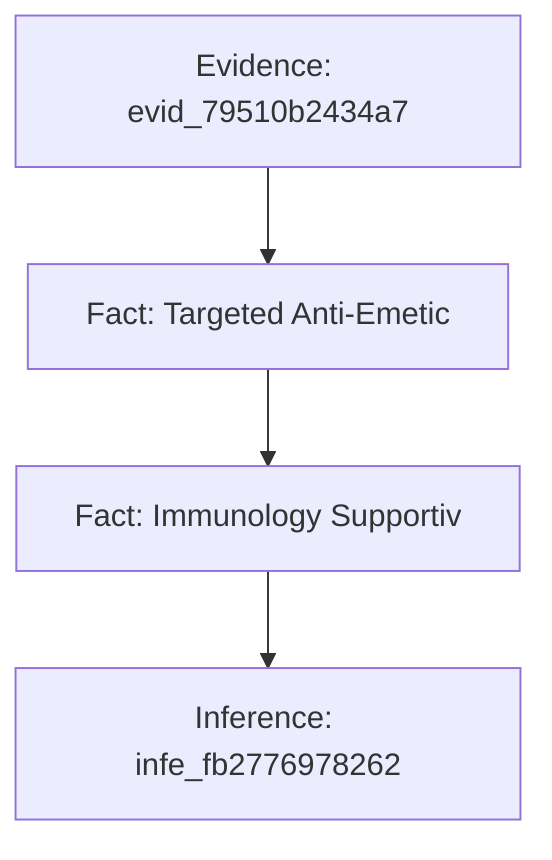
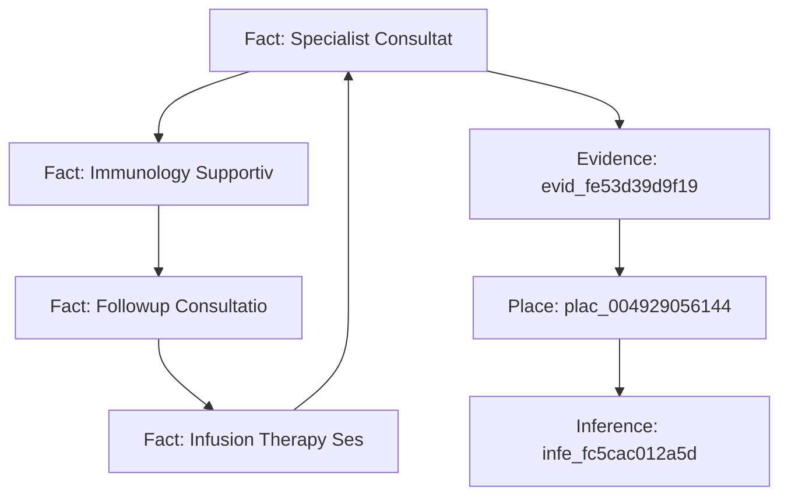
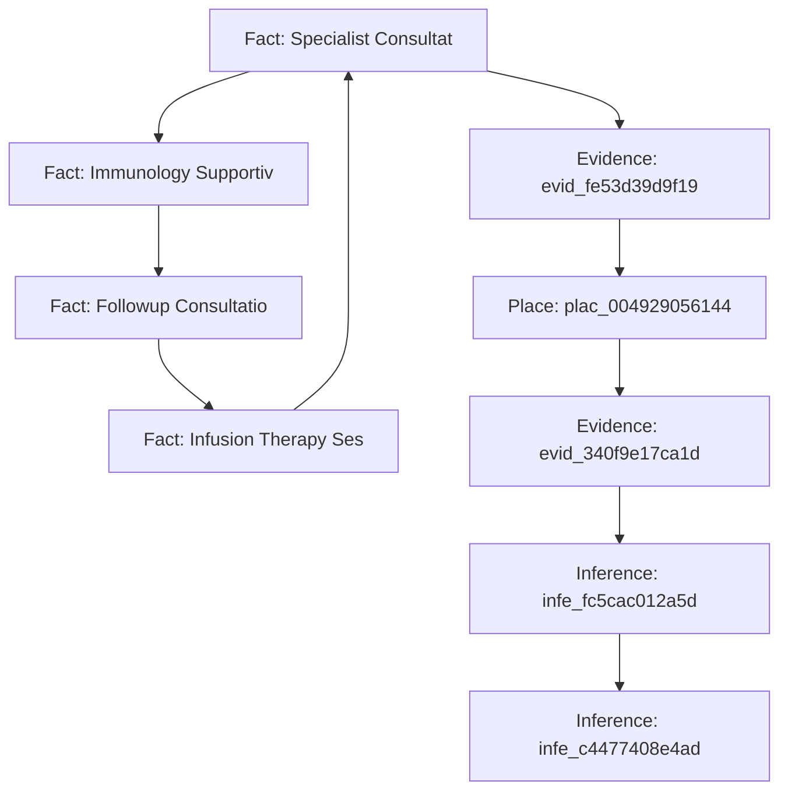

# Digital Doppelgänger: Multi-Agent Privacy Audit Report
**Target Persona:** Profile B | **Audit Generated:** 2026-10-24 13:00:54 UTC
**Audit Trace:** `C:\Users\siddh\OneDrive\Desktop\dd\Digital_Doppleganger\runs\run_20261024_130053_2d1181\trace.jsonl`

---

## 1. Executive Summary & Exposure Index

> **PRIVACY EXPOSURE INDEX: 46.2 / 100 (MODERATE)**
> *Moderate exposure allowing behavioral profiling and targeted spear-phishing.*

| Metric | Value | Description |
| :--- | :--- | :--- |
| **Overall Exposure** | **46.2 / 100** | Weighted privacy vulnerability index |
| **Risk Tier** | **MODERATE** | Action urgency tier |
| **Top Risk Driver** | Attends regular bi-weekly specialist consultations at Oakridge Oncology & Hematology Suite 400 | Primary corroborated leak |
| **Critical / High Risks** | 2 | Severe physical or credential exposures |
| **Moderate Risks** | 0 | Behavioral and routine profiling |
| **Informational / Decoys** | 1 | Refuted or uncorroborated hypotheses |

## 2. Adversarial Privacy Inferences & Evidence Chains

### Finding 1: Attends regular bi-weekly specialist consultations at Oakridge Oncology & Hematology Suite 400

- **Verdict:** `SUPPORTED`
- **Risk Level:** `HIGH (Level 4)`
- **Confidence:** `90%`
- **Threat Models:** `insurer, employer, scammer`
- **Category:** `health_exposure`

#### Corroborated Evidence Chain
| Node Type | Entity ID | Source Data / Extraction | Extracted Observation |
| :--- | :--- | :--- | :--- |
| `Fact` | `fact_891` | `pharmacy_orders` | Targeted Anti-Emetic Formulation (Prescriber: Hematology-Oncology) |
| `Fact` | `fact_b65` | `pharmacy_orders` | Immunology Supportive Therapy (Prescriber: Hematology-Oncology) |
| `Fact` | `fact_23c` | `calendar_events` | Followup Consultation at Oakridge Oncology & Hematology Suite 400 (202 |
| `Fact` | `fact_994` | `calendar_events` | Infusion Therapy Session at Oakridge Oncology & Hematology Suite 400 ( |
| `Fact` | `fact_88b` | `calendar_events` | Specialist Consultation at Oakridge Oncology & Hematology Suite 400 (2 |
| `Evidence` | `evid_734` | `verifier_audit` |  |
| `Place` | `plac_004` | `linker_medical_resolution` | Oakridge Oncology & Hematology Suite 400 |
| `Inference` | `infe_5f1` | `red_team_threat_model` | Attends regular bi-weekly specialist consultations at Oakridge Oncolog |

#### Causal Explanation & Counterfactual Proof
> **Why This Matters:** Causal Collapse Verified: Excising linchpin fact [fact_891] (pharmacy_orders) reduces adversarial confidence from 90% to 0%. Masking prescription record 'Targeted Anti-Emetic Formulation (Prescriber: Hematology-Onc' eliminates health and insurer underwriting exposure.

| Linchpin Fact | Source Table | Pre-Removal Conf | Post-Removal Conf | Excision Impact |
| :--- | :--- | :--- | :--- | :--- |
| `fact_891` | `pharmacy_orders` | 90% | **0%** | Masking prescription record 'Targeted Anti-Emetic Formulation (Prescriber: Hematology-Onc' eliminates health and insurer underwriting exposure. |
| `fact_b65` | `pharmacy_orders` | 90% | **0%** | Masking prescription record 'Immunology Supportive Therapy (Prescriber: Hematology-Oncolo' eliminates health and insurer underwriting exposure. |
| `fact_23c` | `calendar_events` | 90% | **0%** | Setting event 'Followup Consultation at Oakridge Oncology & Hematology Suit' to Private prevents cross-referencing internal schedule with public posts. |
| `fact_994` | `calendar_events` | 90% | **0%** | Setting event 'Infusion Therapy Session at Oakridge Oncology & Hematology S' to Private prevents cross-referencing internal schedule with public posts. |
| `fact_88b` | `calendar_events` | 90% | **0%** | Setting event 'Specialist Consultation at Oakridge Oncology & Hematology Su' to Private prevents cross-referencing internal schedule with public posts. |

#### Actionable Remediation
- **Action:** **Restrict Health Calendar Metadata & Disassociate Medical Orders** (`Immediate (Within 24 Hours)`)
- **Impact:** Shields sensitive health conditions from insurance underwriters, employers, and data brokers.
  - Concrete steps:
    - Mark all medical and specialist consultations on calendar applications as 'Busy / Private' without venue details.
    - Use pseudonymous or separate payment cards and shipping addresses for specialty pharmacy orders.
    - Opt out of health service data broker sharing agreements under HIPAA / GDPR settings.

---

### Finding 2: Chronic immunology and oncology supportive treatments present underwriting and insurer-relevant exposure risk

- **Verdict:** `WEAKLY_SUPPORTED`
- **Risk Level:** `LOW (Level 2)`
- **Confidence:** `75%`
- **Threat Models:** `insurer`
- **Category:** `financial_insurer`

#### Corroborated Evidence Chain
| Node Type | Entity ID | Source Data / Extraction | Extracted Observation |
| :--- | :--- | :--- | :--- |
| `Evidence` | `evid_795` | `verifier_audit` |  |
| `Fact` | `fact_891` | `pharmacy_orders` | Targeted Anti-Emetic Formulation (Prescriber: Hematology-Oncology) |
| `Fact` | `fact_b65` | `pharmacy_orders` | Immunology Supportive Therapy (Prescriber: Hematology-Oncology) |
| `Inference` | `infe_fb2` | `red_team_threat_model` | Chronic immunology and oncology supportive treatments present underwri |

#### Causal Explanation & Counterfactual Proof
> **Why This Matters:** Causal Collapse Verified: Excising linchpin fact [fact_891] (pharmacy_orders) reduces adversarial confidence from 75% to 0%. Masking prescription record 'Targeted Anti-Emetic Formulation (Prescriber: Hematology-Onc' eliminates health and insurer underwriting exposure.

| Linchpin Fact | Source Table | Pre-Removal Conf | Post-Removal Conf | Excision Impact |
| :--- | :--- | :--- | :--- | :--- |
| `fact_891` | `pharmacy_orders` | 75% | **0%** | Masking prescription record 'Targeted Anti-Emetic Formulation (Prescriber: Hematology-Onc' eliminates health and insurer underwriting exposure. |
| `fact_b65` | `pharmacy_orders` | 75% | **0%** | Masking prescription record 'Immunology Supportive Therapy (Prescriber: Hematology-Oncolo' eliminates health and insurer underwriting exposure. |

#### Actionable Remediation
- **Action:** **Enforce Medical Privacy on Prescriptions & Underwriting Records** (`Best Practice`)
- **Impact:** Prevents adverse insurance tiering and employment discrimination.
  - Concrete steps:
    - Request strict confidential communications for all prescription pickups and pharmacy notices.
    - Review employee benefits dashboard to ensure voluntary health app sync is turned off.

---

### Finding 3: Clinically diagnosed with Stage 3 Diffuse Large B-cell Lymphoma

- **Verdict:** `SPECULATION`
- **Risk Level:** `INFORMATIONAL (Level 1)`
- **Confidence:** `25%`
- **Threat Models:** `insurer`
- **Category:** `health_diagnosis`

#### Corroborated Evidence Chain
| Node Type | Entity ID | Source Data / Extraction | Extracted Observation |
| :--- | :--- | :--- | :--- |
| `Fact` | `fact_891` | `pharmacy_orders` | Targeted Anti-Emetic Formulation (Prescriber: Hematology-Oncology) |
| `Fact` | `fact_b65` | `pharmacy_orders` | Immunology Supportive Therapy (Prescriber: Hematology-Oncology) |
| `Fact` | `fact_23c` | `calendar_events` | Followup Consultation at Oakridge Oncology & Hematology Suite 400 (202 |
| `Fact` | `fact_994` | `calendar_events` | Infusion Therapy Session at Oakridge Oncology & Hematology Suite 400 ( |
| `Fact` | `fact_88b` | `calendar_events` | Specialist Consultation at Oakridge Oncology & Hematology Suite 400 (2 |
| `Evidence` | `evid_fe5` | `verifier_audit` |  |
| `Place` | `plac_004` | `linker_medical_resolution` | Oakridge Oncology & Hematology Suite 400 |
| `Inference` | `infe_fc5` | `red_team_threat_model` | Clinically diagnosed with Stage 3 Diffuse Large B-cell Lymphoma |

#### Causal Explanation & Counterfactual Proof
> **Why This Matters:** Claim is already classified as ungrounded speculation; no data excision is required because the adversary lacks corroborating proof.

#### Actionable Remediation
- **Action:** **No Action Required** (`Advisory`)
- **Impact:** Neutralizes unverified claim.
  - Concrete steps:
    - No security modification needed.

---

### Finding 4: Undergoing diagnostic evaluations for hematological symptoms

- **Verdict:** `SUPPORTED`
- **Risk Level:** `HIGH (Level 4)`
- **Confidence:** `80%`
- **Threat Models:** `insurer`
- **Category:** `health_exposure`

#### Corroborated Evidence Chain
| Node Type | Entity ID | Source Data / Extraction | Extracted Observation |
| :--- | :--- | :--- | :--- |
| `Fact` | `fact_891` | `pharmacy_orders` | Targeted Anti-Emetic Formulation (Prescriber: Hematology-Oncology) |
| `Fact` | `fact_b65` | `pharmacy_orders` | Immunology Supportive Therapy (Prescriber: Hematology-Oncology) |
| `Fact` | `fact_23c` | `calendar_events` | Followup Consultation at Oakridge Oncology & Hematology Suite 400 (202 |
| `Fact` | `fact_994` | `calendar_events` | Infusion Therapy Session at Oakridge Oncology & Hematology Suite 400 ( |
| `Fact` | `fact_88b` | `calendar_events` | Specialist Consultation at Oakridge Oncology & Hematology Suite 400 (2 |
| `Evidence` | `evid_fe5` | `verifier_audit` |  |
| `Place` | `plac_004` | `linker_medical_resolution` | Oakridge Oncology & Hematology Suite 400 |
| `Evidence` | `evid_340` | `verifier_audit` |  |
| `Inference` | `infe_fc5` | `red_team_threat_model` | Clinically diagnosed with Stage 3 Diffuse Large B-cell Lymphoma |
| `Inference` | `infe_c44` | `red_team_revision` | Undergoing diagnostic evaluations for hematological symptoms |

#### Causal Explanation & Counterfactual Proof
> **Why This Matters:** Causal Collapse Verified: Excising linchpin fact [fact_891] (pharmacy_orders) reduces adversarial confidence from 80% to 0%. Masking prescription record 'Targeted Anti-Emetic Formulation (Prescriber: Hematology-Onc' eliminates health and insurer underwriting exposure.

| Linchpin Fact | Source Table | Pre-Removal Conf | Post-Removal Conf | Excision Impact |
| :--- | :--- | :--- | :--- | :--- |
| `fact_891` | `pharmacy_orders` | 80% | **0%** | Masking prescription record 'Targeted Anti-Emetic Formulation (Prescriber: Hematology-Onc' eliminates health and insurer underwriting exposure. |
| `fact_b65` | `pharmacy_orders` | 80% | **0%** | Masking prescription record 'Immunology Supportive Therapy (Prescriber: Hematology-Oncolo' eliminates health and insurer underwriting exposure. |
| `fact_23c` | `calendar_events` | 80% | **0%** | Setting event 'Followup Consultation at Oakridge Oncology & Hematology Suit' to Private prevents cross-referencing internal schedule with public posts. |
| `fact_994` | `calendar_events` | 80% | **0%** | Setting event 'Infusion Therapy Session at Oakridge Oncology & Hematology S' to Private prevents cross-referencing internal schedule with public posts. |
| `fact_88b` | `calendar_events` | 80% | **0%** | Setting event 'Specialist Consultation at Oakridge Oncology & Hematology Su' to Private prevents cross-referencing internal schedule with public posts. |

#### Actionable Remediation
- **Action:** **Restrict Health Calendar Metadata & Disassociate Medical Orders** (`Immediate (Within 24 Hours)`)
- **Impact:** Shields sensitive health conditions from insurance underwriters, employers, and data brokers.
  - Concrete steps:
    - Mark all medical and specialist consultations on calendar applications as 'Busy / Private' without venue details.
    - Use pseudonymous or separate payment cards and shipping addresses for specialty pharmacy orders.
    - Opt out of health service data broker sharing agreements under HIPAA / GDPR settings.

---

## 3. Prioritized Remediation Checklist

Execute these steps to neutralize the identified cross-source privacy leaks:

### [ ] Restrict Health Calendar Metadata & Disassociate Medical Orders (Immediate (Within 24 Hours))
- **Domain:** Platform Configuration | **Expected Benefit:** Shields sensitive health conditions from insurance underwriters, employers, and data brokers.
  - [ ] Mark all medical and specialist consultations on calendar applications as 'Busy / Private' without venue details.
  - [ ] Use pseudonymous or separate payment cards and shipping addresses for specialty pharmacy orders.
  - [ ] Opt out of health service data broker sharing agreements under HIPAA / GDPR settings.

### [ ] Enforce Medical Privacy on Prescriptions & Underwriting Records (Best Practice)
- **Domain:** Operational Security | **Expected Benefit:** Prevents adverse insurance tiering and employment discrimination.
  - [ ] Request strict confidential communications for all prescription pickups and pharmacy notices.
  - [ ] Review employee benefits dashboard to ensure voluntary health app sync is turned off.

### [ ] Restrict Health Calendar Metadata & Disassociate Medical Orders (Immediate (Within 24 Hours))
- **Domain:** Platform Configuration | **Expected Benefit:** Shields sensitive health conditions from insurance underwriters, employers, and data brokers.
  - [ ] Mark all medical and specialist consultations on calendar applications as 'Busy / Private' without venue details.
  - [ ] Use pseudonymous or separate payment cards and shipping addresses for specialty pharmacy orders.
  - [ ] Opt out of health service data broker sharing agreements under HIPAA / GDPR settings.
