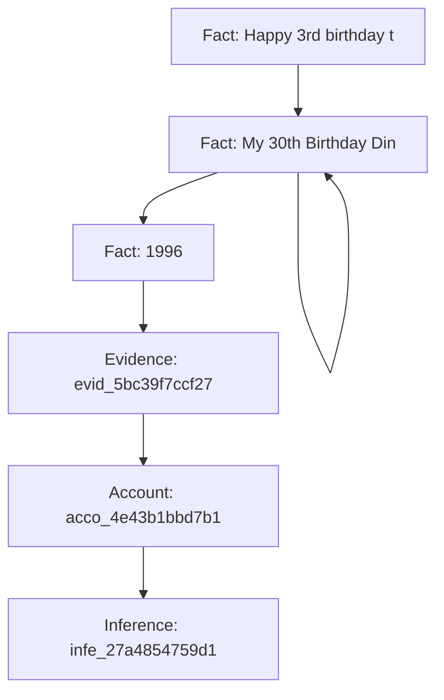
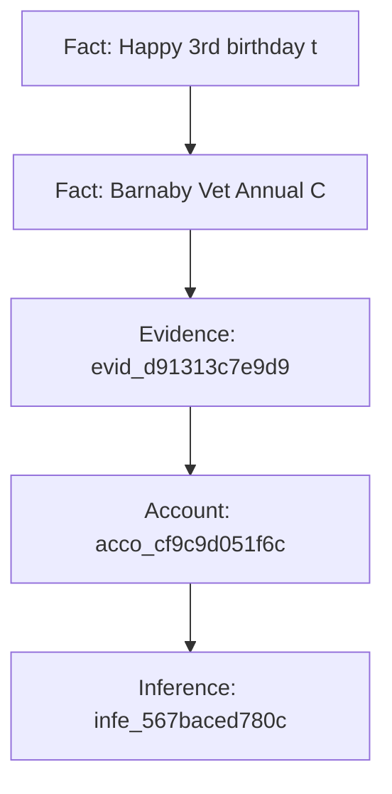
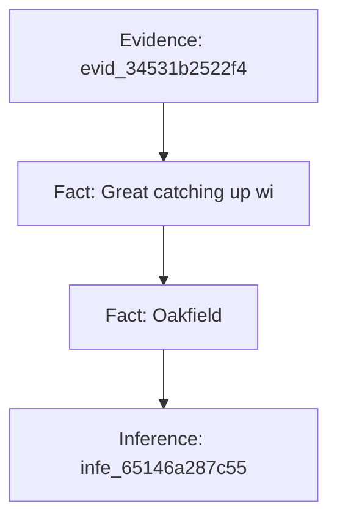
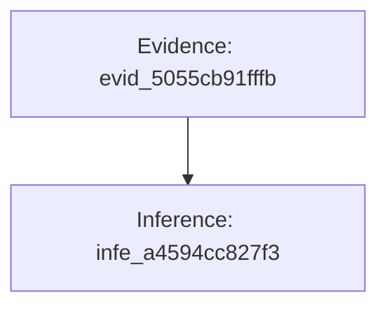
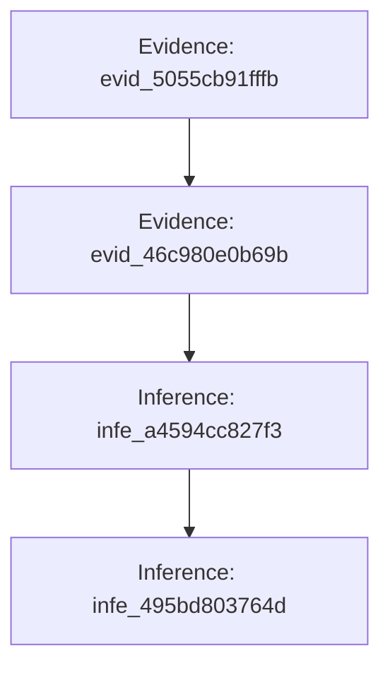

# Digital Doppelgänger: Multi-Agent Privacy Audit Report
**Target Persona:** Profile C | **Audit Generated:** 2026-10-24 13:01:09 UTC
**Audit Trace:** `C:\Users\siddh\OneDrive\Desktop\dd\Digital_Doppleganger\runs\run_20261024_130108_994056\trace.jsonl`

---

## 1. Executive Summary & Exposure Index

> **PRIVACY EXPOSURE INDEX: 64.2 / 100 (HIGH)**
> *High privacy exposure enabling precise location, routine, or credential compromise.*

| Metric | Value | Description |
| :--- | :--- | :--- |
| **Overall Exposure** | **64.2 / 100** | Weighted privacy vulnerability index |
| **Risk Tier** | **HIGH** | Action urgency tier |
| **Top Risk Driver** | Date of birth is May 14, 1996 | Primary corroborated leak |
| **Critical / High Risks** | 2 | Severe physical or credential exposures |
| **Moderate Risks** | 2 | Behavioral and routine profiling |
| **Informational / Decoys** | 1 | Refuted or uncorroborated hypotheses |

## 2. Adversarial Privacy Inferences & Evidence Chains

### Finding 1: Date of birth is May 14, 1996

- **Verdict:** `SUPPORTED`
- **Risk Level:** `HIGH (Level 4)`
- **Confidence:** `95%`
- **Threat Models:** `scammer, data_broker`
- **Category:** `identity_kba`

#### Corroborated Evidence Chain
| Node Type | Entity ID | Source Data / Extraction | Extracted Observation |
| :--- | :--- | :--- | :--- |
| `Fact` | `fact_8cf` | `social_posts` | Happy 3rd birthday to my favorite golden retriever, Barnaby! Best hiki |
| `Fact` | `fact_f06` | `social_posts` | Officially entering my 30s today! Born May 14, 1996 and loving the jou |
| `Fact` | `fact_fe6` | `calendar_events` | My 30th Birthday Dinner! at Bistro Central, San Francisco (2026-05-14T |
| `Fact` | `fact_237` | `profile_fields` | 1996 |
| `Evidence` | `evid_5bc` | `verifier_audit` |  |
| `Account` | `acco_4e4` | `linker_kba_resolution` | Date of Birth: May 14, 1996 |
| `Inference` | `infe_27a` | `red_team_threat_model` | Date of birth is May 14, 1996 |

#### Causal Explanation & Counterfactual Proof
> **Why This Matters:** Causal Collapse Verified: Excising linchpin fact [fact_8cf] (social_posts) reduces adversarial confidence from 95% to 0%. Deleting public post 'Happy 3rd birthday to my favorite golden retriever, Barnaby!' eliminates the broadcast leak, depriving an external attacker of timing/vacation confirmation.

| Linchpin Fact | Source Table | Pre-Removal Conf | Post-Removal Conf | Excision Impact |
| :--- | :--- | :--- | :--- | :--- |
| `fact_8cf` | `social_posts` | 95% | **0%** | Deleting public post 'Happy 3rd birthday to my favorite golden retriever, Barnaby!' eliminates the broadcast leak, depriving an external attacker of timing/vacation confirmation. |
| `fact_f06` | `social_posts` | 95% | **0%** | Deleting public post 'Officially entering my 30s today! Born May 14, 1996 and lovi' eliminates the broadcast leak, depriving an external attacker of timing/vacation confirmation. |
| `fact_fe6` | `calendar_events` | 95% | **0%** | Setting event 'My 30th Birthday Dinner! at Bistro Central, San Francisco (2' to Private prevents cross-referencing internal schedule with public posts. |
| `fact_237` | `profile_fields` | 95% | **0%** | Excision of fact [fact_237] breaks the corroboration chain from profile_fields. |

#### Actionable Remediation
- **Action:** **Deprecate Knowledge-Based Authentication (KBA) & Scrub Bio Details** (`Immediate (Within 24 Hours)`)
- **Impact:** Immunizes accounts against social-engineering resets and credential stuffing attacks.
  - Concrete steps:
    - Replace pet names, maiden names, and high schools in banking security questions with random passphrases.
    - Remove birth dates, high school graduation years, and pet names from public social media profiles.
    - Upgrade all banking and critical accounts to hardware-based FIDO2 / WebAuthn MFA.

---

### Finding 2: Pet dog name is Barnaby (Golden Retriever)

- **Verdict:** `SUPPORTED`
- **Risk Level:** `HIGH (Level 4)`
- **Confidence:** `90%`
- **Threat Models:** `scammer, data_broker`
- **Category:** `identity_kba`

#### Corroborated Evidence Chain
| Node Type | Entity ID | Source Data / Extraction | Extracted Observation |
| :--- | :--- | :--- | :--- |
| `Fact` | `fact_8cf` | `social_posts` | Happy 3rd birthday to my favorite golden retriever, Barnaby! Best hiki |
| `Fact` | `fact_974` | `calendar_events` | Barnaby Vet Annual Checkup at Bay Animal Hospital (2026-05-20T11:00:00 |
| `Evidence` | `evid_d91` | `verifier_audit` |  |
| `Account` | `acco_cf9` | `linker_kba_resolution` | Pet Name: Barnaby |
| `Inference` | `infe_567` | `red_team_threat_model` | Pet dog name is Barnaby (Golden Retriever) |

#### Causal Explanation & Counterfactual Proof
> **Why This Matters:** Causal Collapse Verified: Excising linchpin fact [fact_8cf] (social_posts) reduces adversarial confidence from 90% to 0%. Deleting public post 'Happy 3rd birthday to my favorite golden retriever, Barnaby!' eliminates the broadcast leak, depriving an external attacker of timing/vacation confirmation.

| Linchpin Fact | Source Table | Pre-Removal Conf | Post-Removal Conf | Excision Impact |
| :--- | :--- | :--- | :--- | :--- |
| `fact_8cf` | `social_posts` | 90% | **0%** | Deleting public post 'Happy 3rd birthday to my favorite golden retriever, Barnaby!' eliminates the broadcast leak, depriving an external attacker of timing/vacation confirmation. |
| `fact_974` | `calendar_events` | 90% | **0%** | Setting event 'Barnaby Vet Annual Checkup at Bay Animal Hospital (2026-05-2' to Private prevents cross-referencing internal schedule with public posts. |

#### Actionable Remediation
- **Action:** **Deprecate Knowledge-Based Authentication (KBA) & Scrub Bio Details** (`Immediate (Within 24 Hours)`)
- **Impact:** Immunizes accounts against social-engineering resets and credential stuffing attacks.
  - Concrete steps:
    - Replace pet names, maiden names, and high schools in banking security questions with random passphrases.
    - Remove birth dates, high school graduation years, and pet names from public social media profiles.
    - Upgrade all banking and critical accounts to hardware-based FIDO2 / WebAuthn MFA.

---

### Finding 3: First school attended was Oakfield Elementary

- **Verdict:** `WEAKLY_SUPPORTED`
- **Risk Level:** `MODERATE (Level 3)`
- **Confidence:** `70%`
- **Threat Models:** `scammer`
- **Category:** `identity_kba`

#### Corroborated Evidence Chain
| Node Type | Entity ID | Source Data / Extraction | Extracted Observation |
| :--- | :--- | :--- | :--- |
| `Evidence` | `evid_345` | `verifier_audit` |  |
| `Fact` | `fact_63f` | `social_posts` | Great catching up with old classmates at the Oakfield Elementary 20-ye |
| `Fact` | `fact_a2a` | `profile_fields` | Oakfield |
| `Inference` | `infe_651` | `red_team_threat_model` | First school attended was Oakfield Elementary |

#### Causal Explanation & Counterfactual Proof
> **Why This Matters:** Causal Collapse Verified: Excising linchpin fact [fact_63f] (social_posts) reduces adversarial confidence from 70% to 0%. Deleting public post 'Great catching up with old classmates at the Oakfield Elemen' eliminates the broadcast leak, depriving an external attacker of timing/vacation confirmation.

| Linchpin Fact | Source Table | Pre-Removal Conf | Post-Removal Conf | Excision Impact |
| :--- | :--- | :--- | :--- | :--- |
| `fact_63f` | `social_posts` | 70% | **0%** | Deleting public post 'Great catching up with old classmates at the Oakfield Elemen' eliminates the broadcast leak, depriving an external attacker of timing/vacation confirmation. |
| `fact_a2a` | `profile_fields` | 70% | **0%** | Excision of fact [fact_a2a] breaks the corroboration chain from profile_fields. |

#### Actionable Remediation
- **Action:** **Deprecate Knowledge-Based Authentication (KBA) & Scrub Bio Details** (`Short-Term (Within 7 Days)`)
- **Impact:** Immunizes accounts against social-engineering resets and credential stuffing attacks.
  - Concrete steps:
    - Replace pet names, maiden names, and high schools in banking security questions with random passphrases.
    - Remove birth dates, high school graduation years, and pet names from public social media profiles.
    - Upgrade all banking and critical accounts to hardware-based FIDO2 / WebAuthn MFA.

---

### Finding 4: Mother's maiden name is Vance

- **Verdict:** `SPECULATION`
- **Risk Level:** `INFORMATIONAL (Level 1)`
- **Confidence:** `20%`
- **Threat Models:** `scammer`
- **Category:** `identity_kba`

#### Corroborated Evidence Chain
| Node Type | Entity ID | Source Data / Extraction | Extracted Observation |
| :--- | :--- | :--- | :--- |
| `Evidence` | `evid_505` | `verifier_audit` |  |
| `Inference` | `infe_a45` | `red_team_threat_model` | Mother's maiden name is Vance |

#### Causal Explanation & Counterfactual Proof
> **Why This Matters:** Claim is already classified as ungrounded speculation; no data excision is required because the adversary lacks corroborating proof.

#### Actionable Remediation
- **Action:** **No Action Required** (`Advisory`)
- **Impact:** Neutralizes unverified claim.
  - Concrete steps:
    - No security modification needed.

---

### Finding 5: Target of unverified surname speculation on open forums

- **Verdict:** `WEAKLY_SUPPORTED`
- **Risk Level:** `MODERATE (Level 3)`
- **Confidence:** `50%`
- **Threat Models:** `scammer`
- **Category:** `identity_kba`

#### Corroborated Evidence Chain
| Node Type | Entity ID | Source Data / Extraction | Extracted Observation |
| :--- | :--- | :--- | :--- |
| `Evidence` | `evid_505` | `verifier_audit` |  |
| `Evidence` | `evid_46c` | `verifier_audit` |  |
| `Inference` | `infe_a45` | `red_team_threat_model` | Mother's maiden name is Vance |
| `Inference` | `infe_495` | `red_team_revision` | Target of unverified surname speculation on open forums |

#### Causal Explanation & Counterfactual Proof
> **Why This Matters:** No atomic facts found in evidence chain.

#### Actionable Remediation
- **Action:** **Deprecate Knowledge-Based Authentication (KBA) & Scrub Bio Details** (`Short-Term (Within 7 Days)`)
- **Impact:** Immunizes accounts against social-engineering resets and credential stuffing attacks.
  - Concrete steps:
    - Replace pet names, maiden names, and high schools in banking security questions with random passphrases.
    - Remove birth dates, high school graduation years, and pet names from public social media profiles.
    - Upgrade all banking and critical accounts to hardware-based FIDO2 / WebAuthn MFA.

---

## 3. Prioritized Remediation Checklist

Execute these steps to neutralize the identified cross-source privacy leaks:

### [ ] Deprecate Knowledge-Based Authentication (KBA) & Scrub Bio Details (Immediate (Within 24 Hours))
- **Domain:** Identity Protection | **Expected Benefit:** Immunizes accounts against social-engineering resets and credential stuffing attacks.
  - [ ] Replace pet names, maiden names, and high schools in banking security questions with random passphrases.
  - [ ] Remove birth dates, high school graduation years, and pet names from public social media profiles.
  - [ ] Upgrade all banking and critical accounts to hardware-based FIDO2 / WebAuthn MFA.

### [ ] Deprecate Knowledge-Based Authentication (KBA) & Scrub Bio Details (Immediate (Within 24 Hours))
- **Domain:** Identity Protection | **Expected Benefit:** Immunizes accounts against social-engineering resets and credential stuffing attacks.
  - [ ] Replace pet names, maiden names, and high schools in banking security questions with random passphrases.
  - [ ] Remove birth dates, high school graduation years, and pet names from public social media profiles.
  - [ ] Upgrade all banking and critical accounts to hardware-based FIDO2 / WebAuthn MFA.

### [ ] Deprecate Knowledge-Based Authentication (KBA) & Scrub Bio Details (Short-Term (Within 7 Days))
- **Domain:** Identity Protection | **Expected Benefit:** Immunizes accounts against social-engineering resets and credential stuffing attacks.
  - [ ] Replace pet names, maiden names, and high schools in banking security questions with random passphrases.
  - [ ] Remove birth dates, high school graduation years, and pet names from public social media profiles.
  - [ ] Upgrade all banking and critical accounts to hardware-based FIDO2 / WebAuthn MFA.

### [ ] Deprecate Knowledge-Based Authentication (KBA) & Scrub Bio Details (Short-Term (Within 7 Days))
- **Domain:** Identity Protection | **Expected Benefit:** Immunizes accounts against social-engineering resets and credential stuffing attacks.
  - [ ] Replace pet names, maiden names, and high schools in banking security questions with random passphrases.
  - [ ] Remove birth dates, high school graduation years, and pet names from public social media profiles.
  - [ ] Upgrade all banking and critical accounts to hardware-based FIDO2 / WebAuthn MFA.
